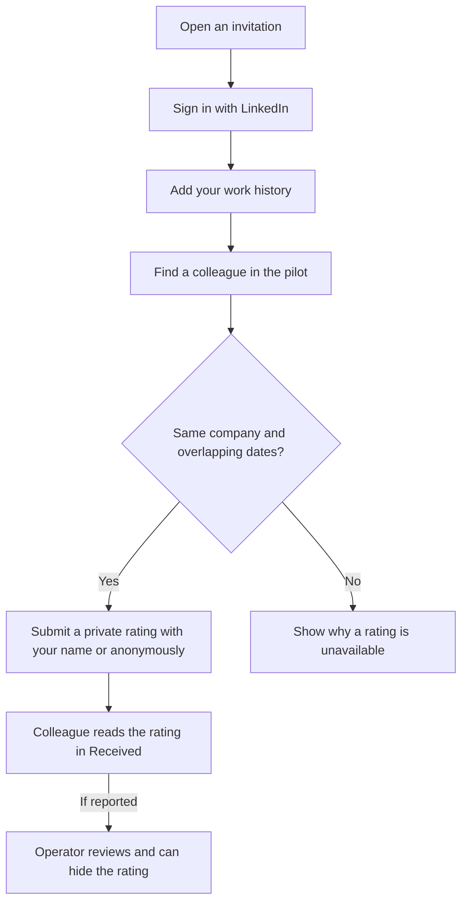
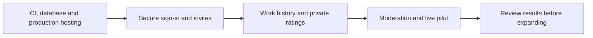

# E-ProRate launch plan

## Goal and first release

Launch E-ProRate on an HTTPS domain with a public landing page and an invite-only pilot. Two invited colleagues should be able to sign in with LinkedIn, add their own work history, and exchange private ratings when their employment dates overlap at the same company. A participant can report a rating, and an operator can review and hide it.

## How the service works

Both colleagues add their own employment dates. E-ProRate checks the dates against each other, and LinkedIn handles account sign-in. The author sees their submission in **Given**. The recipient sees the feedback in **Received**, with the author's identity hidden when anonymous mode is selected. Authorized staff can review attribution to resolve a report.

## How we’ll build it

The existing React app provides the screens. The NestJS API handles sign-in, checks who can submit or view each rating, and applies the overlap rule. PostgreSQL stores accounts, work histories, ratings, and reports. The pilot uses the Heroku client app as its public HTTPS origin. The client forwards API requests to a separate Heroku app, which stores pilot data in Neon PostgreSQL.

Start from the restored `codex/restored-main` checkout at `1da60e2`. The TypeScript client and NestJS server build. The server has a LinkedIn sign-in scaffold and a health endpoint. Search, profiles, eligibility, and rating submission still use demo data or browser-only logic. The `main-server` branch has in-memory prototypes whose endpoints allow unauthorized profile writes and forged rating authors. Use the restored default branch as the implementation baseline. [Original investigation](E-ProRate_Adjustment_Plan.md) · [Restored source](https://github.com/MicroSaaSs/EmployeeRating/commit/1da60e2236aeb0e61a6467ff7e1c88a83263c746)

| Phase | Outcome | Depends on |
| --- | --- | --- |
| 1. Foundation | Reproducible setup, PostgreSQL, and production hosting | Restored baseline |
| 2. Sign-in and invitations | An invited participant can sign in securely in production | Phase 1 |
| 3. Work history and ratings | Two eligible participants can exchange private ratings | Phase 2 |
| 4. Launch | Moderation works and the pilot is live on the production domain | Phase 3 |
| 5. Evaluate and expand | Decide whether to open the next cohort or revise the product | Pilot results |

## Phase 1. Set up the foundation

- [ ] **Make builds reproducible.** Pin a supported Node version for both packages and CI. Regenerate the client lockfile from the current manifest, generate a server lockfile, and commit both. Run `npm ci`, both builds, and the client TypeScript check in CI. Update the README with the actual client and server startup commands.
- [ ] **Add PostgreSQL and migrations.** Use one database per environment and versioned SQL migrations applied by the server CLI. Start with `users`, `sessions`, `oauth_attempts`, and `invites`. Add the ratings tables in Phase 3. Use stable internal user IDs and a unique LinkedIn issuer/subject pair for account lookup within the environment.
- [ ] **Bring up production over HTTPS.** Deploy the Vite build to `e-prorate-client` and NestJS to `e-prorate-api`. Route `/api/*` to NestJS and let the remaining application paths fall back to Vite's `index.html`. Use the same `/api` path through a Vite proxy in development. Keep database credentials and LinkedIn secrets on the server through the hosting provider's secret store.
- [ ] **Set up deployment access.** Choose the hosting account and domain, name the person responsible for pilot support, and configure the LinkedIn app with the OpenID Connect product. Register the full production client URL for `/api/auth/linkedin/callback` and document the required settings, including `DATABASE_URL`, `CLIENT_APP_URL`, `LINKEDIN_CLIENT_ID`, `LINKEDIN_CLIENT_SECRET`, and `LINKEDIN_REDIRECT_URI`.

**Exit check** — From a clean checkout, CI builds both packages and applies migrations to an empty database. The production client serves the UI and `/api/health` over HTTPS. A direct visit to a client route loads the app, and missing API routes return API errors.

## Phase 2. Make sign-in and invitations work

- [ ] **Harden the LinkedIn callback.** Bind a short-lived, single-use OAuth `state` value to the browser that starts sign-in. Reject missing, mismatched, expired, and replayed values. Use LinkedIn’s confidential authorization-code flow and validate the ID token signature, issuer, audience, subject, and expiry. LinkedIn’s documented web sign-in flow uses state for this callback. Use the configured callback and client URLs so local sign-in returns to port `4028` and production returns to the Heroku client origin. [LinkedIn OpenID Connect guide](https://learn.microsoft.com/en-us/linkedin/consumer/integrations/self-serve/sign-in-with-linkedin-v2) · [LinkedIn authorization-code flow](https://learn.microsoft.com/en-us/linkedin/shared/authentication/authorization-code-flow) · [OAuth security best practice](https://www.rfc-editor.org/rfc/rfc9700.html)
- [ ] **Make PostgreSQL the session authority.** Issue a fresh, expiring session after login, store a digest of the session identifier, and revoke the session on logout. Use an `HttpOnly`, `SameSite=Lax` cookie with `Secure` on HTTPS. Return only the display fields needed by the UI from `/api/auth/session`, remove the browser `localStorage` session copy, and strip OAuth codes, provider tokens, and session IDs from logs. Use same-origin requests and reject cross-origin state-changing requests.
- [ ] **Enforce invitations on the server.** Give the operator a way to issue expiring, single-use invite links. Redeem each link atomically when the invited person completes sign-in. Allow returning participants to sign in directly. Route authenticated users to onboarding or their dashboard and provide a clear recovery message for expired invites and failed sign-in.
- [ ] **Cover the failure paths.** Add integration checks for invalid OAuth state, session expiry and logout, invitation reuse, and access to protected endpoints without a valid session. Complete a real LinkedIn sign-in in production with a test participant.

**Exit check** — A person with an invite can sign in with LinkedIn, reload, stay signed in after an API restart, and log out. A reused invite or unauthenticated API call grants no access. Verify that both local storage and response bodies are free of session identifiers and provider tokens.

## Phase 3. Complete the core rating flow

1. **Work history.**
   - [ ] Let participants add, edit, and remove their own employer, title, start date, and optional end date. Store structured dates and a canonical company ID. Let an operator resolve ambiguous company names during the pilot. Label the entries as self-reported. LinkedIn sign-in supplies account and basic profile information. [LinkedIn OpenID Connect guide](https://learn.microsoft.com/en-us/linkedin/consumer/integrations/self-serve/sign-in-with-linkedin-v2)
   - [ ] Replace the simulated LinkedIn work-history UI with this data. Show only the directory fields participants agree to share. Seed demo accounts in local development only.
2. **Eligibility and navigation.**
   - [ ] Search the pilot directory by name and use stable routes such as `/professionals/:id` and `/professionals/:id/rate`. Load the selected participant from the API and handle hidden, missing, and ineligible profiles.
   - [ ] On the server, require both active pilot accounts to have overlapping date ranges for the same company. Treat an open end date as today and use inclusive date boundaries for the pilot. Reject self-ratings and non-overlapping history. Save the minimum eligibility evidence and rule version with the rating for staff review. Treat overlap as an eligibility signal based on the participants' reports.
3. **Private rating submission and visibility.**
   - [ ] Persist the overall score, category scores, written feedback, and author visibility choice. Derive the author from the session and validate the payload. Enforce one rating per author and recipient in PostgreSQL. Allow the author to edit the existing rating and recheck eligibility when its content changes. Save the rating and its eligibility evidence atomically so retries and concurrent requests cannot create duplicates.
   - [ ] Populate the existing Given and Received views from the API. Give the author access to their own submission and the recipient access to ratings addressed to them. For anonymous ratings, omit the author ID and identifying details from recipient responses and restrict attribution to authorized dispute reviewers. Allow each participant to inspect another person's data only through explicitly permitted fields. Remove fixture scores and simulated submission success from the pilot UI.
   - [ ] Test eligible and ineligible date ranges, concurrent submission, forged author IDs, access by an unrelated account, and anonymous response fields.

**Exit check** — In the production smoke test, two invited users with overlapping work history complete the flow from search to persisted rating and see the correct Given and Received views after reload. A third user cannot read their private rating. A user with disjoint dates cannot submit one by calling the API directly.

## Phase 4. Launch the production pilot

- [ ] **Put moderation in place.** Add a report action to each received rating, an internal queue, and a way to hide or reinstate content with audited decisions. Restrict staff access by role. Add basic invite and write rate limits and an operator control to pause new submissions while preserving access to existing ones.
- [ ] **Publish the landing page and pilot rules.** Adapt the existing sign-in page to explain the pilot, give returning participants a sign-in entry point, and link the privacy notice and support contact. Explain who can see each rating, what anonymous mode hides, how to report content, and how participants can request account and data removal. Give the operator a procedure to handle removal requests and revoke access.
- [ ] **Prepare production.** Set up the domain, TLS, production LinkedIn app and exact callback, database migrations, and backups. Exercise a backup restore in an isolated database. Add health and error alerts, redacted logs, and a short rollback checklist with the prior application release and database recovery steps.
- [ ] **Release to one cohort.** Run the production smoke check with test accounts first. Check the public landing page, invitation, LinkedIn sign-in, eligibility, rating visibility, reporting, and logout. Then invite one group of colleagues who have worked together so participants have a reasonable chance of finding a match.

**Exit check** — The landing page is reachable on the production HTTPS domain. Pilot participants can complete the full flow. The operator can receive and resolve a report, pause submissions, and restore from a tested backup.

## Phase 5. Decide what to expand

- [ ] **Measure the pilot.** Review invite redemption, LinkedIn sign-in success, work-history completion, the share of activated users who find an eligible colleague, ratings submitted and viewed, and report volume and response times. Use aggregate counts and omit feedback text from analytics. A proposed first checkpoint is three distinct colleague pairs completing the flow and each pilot report receiving an operator response before inviting a second cohort.
- [ ] **Fix the largest drop-off.** Use short participant interviews and the pilot counts to decide whether to improve onboarding, employer matching, or the feedback experience. Confirm that participants understand rating visibility and self-reported eligibility.
- [ ] **Treat broader visibility as its own release.** Before publishing profiles or ratings about people outside the pilot, define how subjects are notified, distinguish people with similar names, require explicit confirmation before attaching a claim, test dispute and takedown handling, and decide which data may appear in public. Consider consents and visibility before offering recruiter access. Revisit subscriptions, analytics exports, notifications, PWA, and Telegram once the core flow shows repeat use.

## Implementation status

The workspace contains both lockfiles, the CI workflow, versioned PostgreSQL migrations, the pilot screens, and a deployable container configuration. Local checks covered clean installs, both builds, client type checking, signed ID-token validation with test keys, and the invite, rating, privacy, and moderation flows against PostgreSQL.

The operator's **Pilot operations** screen supports creating and revoking participant invitations and reviewing aggregate pilot activity. The report includes invitation redemptions, sign-ins, participation and eligibility, ratings opened, and the time to first moderation decision.

Work history imports LinkedIn profile PDFs and Positions CSV files locally. Participants can review estimated dates and see which positions are already saved. **Pilot operations → Companies** lets operators search company names and aliases, preview the affected work history entries, and link spelling variants that refer to the same employer.

The participant dashboard points to work history or eligible colleagues as their account progresses. It shows directory visibility and the count of unopened ratings.

Colleague search accepts LinkedIn profile links added by participants in the work-history directory settings. Links are self-reported. Searches respect directory visibility, suspension, and work-history eligibility.

For colleagues outside the pilot, participants can import a saved LinkedIn PDF into a private draft and request an invitation. Operators review requests under **Pilot operations → Requests** and prepare a single-use participant link. A draft's work history is private to its owner. The colleague completes the existing sign-in and onboarding flow after receiving an invitation.

Shared-date checks use the participant's saved work history and company aliases. A local browser-extension prototype exists, but it is deferred: the product must work without users installing extensions.

### Private draft corrections — 20 November 2026

- [x] Reopen a saved private draft to correct the colleague name, roles and dates before requesting an invitation. Preserve exact saved dates and ongoing positions.
- [x] Keep the profile link fixed during editing and update the existing record. Cancel leaves the saved record unchanged. Clear overlap results whenever roles or dates change.
- [x] Retain edits when saving fails, including an invitation requested in the meantime. Keep requested drafts locked under the existing server rule.
- [x] Validate correction/upsert behavior against isolated PostgreSQL and exercise edit, overlap, cancellation, role removal and invitation conflicts in a browser fixture with in-memory endpoints. No actual colleague draft or invitation was created during these checks.

A participant-approved live capture produced five positions across four employers, including two roles at one employer. The local overlap check returned the expected shared dates. The populated review was left unsaved during the check.

### LinkedIn import — tab sharing, 18 November 2026

**Accepted direction:** Use the participant's normal LinkedIn tab and existing login without installing an extension. The user approved tab sharing after the server fetch and hosted browser experiments failed.

**Current flow:** Profile link → normal Experience tab → native browser tab-sharing permission → preview and optional tab zoom → text-area selection → single-view or continuous local reading → stop → draft roles → existing work-history review and duplicate detection → explicit save.

- [x] Open the Experience page in a normal new tab.
- [x] Accept only a selected browser tab. Reject whole-screen/window capture and stop those tracks before processing. Do not request audio; stop any unexpected audio tracks.
- [x] Use tab selection, crop selection and Start reading as the explicit import action; remove the redundant preview-confirmation checkbox. Allow a crop around the Experience column and provide a clear stop control.
- [x] Run OCR in a browser worker with first-party English/Russian models. Default to English for English pages. No image or recognized-text upload, storage API, or third-party OCR service is used.
- [x] Guide users through ordered Open → Share → Start reading steps. Keep sharing disabled until the Experience link has been opened. Default to continuous reading with scrolling inside the captured preview. Offer an optional single-view read that stops automatically. Continuous reading has an always-available Stop and review control that cancels in-flight OCR and unlocks review immediately.
- [x] Read only stable, changed views; unchanged views do not consume the capture limit. Require an explicit text-area selection (or deliberate full-tab override). Use word alignment and confidence to exclude logo glyphs and unreadable lines, trim verification/sticky-title noise, and consolidate small employer-prefix artifacts without combining different titles, dates or employers.
- [x] Permit raw OCR correction and row discard, and replace the last capture's rows when its text is corrected.
- [x] Stop capture on the native stop action, page exit, review handoff, five-minute timeout, or 30 different captured views. Terminate the OCR worker when sharing stops. Leave draft roles in page memory for review, not in persistent storage.
- [x] Reuse the existing date estimates, required missing-date fields, saved-entry matching, and server duplicate protection. Never save directly from OCR.
- [x] Remove the failed hosted-browser UI, services, endpoints, automation dependency and public HTML-fetch route.
- [x] Verify real browser OCR under the app's security policy and with first-party assets. Verify the real tab-sharing permission/preview/capture/review flow with the participant.
- [ ] Release the same commit through `main-api` and then `main-client`. Verify the API migrations and both production health endpoints.

**Evidence:** A browser worker read three visible roles during the participant-approved shared-tab test. Two date labels needed review in the first mixed-language build. English is now the default, and regression tests cover date separators and replacement of old rows when recognized text is corrected. All three previously saved roles were marked **Already saved** after review. The repository uses synthetic images for OCR regression testing.

**Grouped-employer accuracy follow-up, 19 November:** Inspect the actual colleague Experience layout and validate temporary viewport captures. Carry an employer across its grouped roles, exclude location/skill metadata, reset context for individual employers, normalize compact duration suffixes and AI letter lookalikes, and separate disconnected sidebar text from headers. Skip clipped/unreadable date rows until a fuller overlapping view is available. Narrow and wide real-capture regressions both produce exactly five correct roles with no duplicate variants. Add focused regressions for grouped context, duration aliases, right-column contamination and clipped dates. Temporary profile pixels are removed from the local build after validation.

**Colleague import follow-up, 18 November:** Reuse the shared-tab parser inside Find colleagues and Private colleague drafts. A directory link search with no match prefills an inline import; a direct import button also accepts a new link. Preserve uncertain-heading flags, require the colleague’s name and field review, and reuse the private-draft overlap/save endpoints. Directory eligibility still comes from participant records. Closing the panel ends capture. An isolated browser regression exercises link prefill, capture cleanup, real local OCR, role handoff, required-name validation, overlap checking and save payloads using in-memory endpoints; no own-work-history writes or automatic invitation requests occur.

**Edit-pencil/duplicate follow-up, 18 November:** Exclude detached right-edge edit-icon glyphs from header OCR using word coordinates. The glyph had been read as “74”, changing four job titles and preventing saved-entry matches. Preserve actual numeric/version suffixes when they are part of normal title text. Treat Latin C and Cyrillic С as equivalent only in the initial technology label 1C for title matching. A regression reproduces all five reported roles and their saved dates; the browser pixel fixture now includes edit pencils and asserts exact titles.

**Preview-scrolling and accuracy follow-up, 18 November:** Use CaptureController.forwardWheel on the preview, enabled from Start reading or an explicit control with browser-owned permission. Request no focus change after selecting the tab. Default to continuous reading at 100% zoom and warn below 85%. Browser APIs require real user wheel gestures; full-document fitting and unattended scrolling are not offered. Re-read individual date-anchored job headers at higher resolution, preserve unreadable dated roles for review, and replace placeholders when a clearer overlapping view is read. A realistic five-role browser OCR regression at simulated 67% source scale recovers all five titles/employers despite long descriptions and a misleading media caption.

**Earlier single-view follow-up, 18 November:** Add feature-detected Chrome Captured Surface Control zoom buttons, invoked only by the participant with browser-owned permission. Added a single-view mode that automatically releases capture; the later preview-scrolling follow-up makes continuous reading the default again. Zoom may fit shorter histories, but no web API here captures arbitrary offscreen content or guarantees the whole document fits. Zoom is not automatically changed or restored; users can reset it before reading.

**Follow-up, 18 November:** Screenshots of 11 noisy draft variants exposed repeated recognition of unchanged/moving views and icon/header contamination. The follow-up adds the guided single-session UI, stable-view sampling, word confidence/alignment filtering, and targeted draft consolidation. Regression tests cover those cases; OCR remains a draft source requiring review.

**Constraints:** This reads visible pixels rather than another website's DOM, tokens, or cookies. The participant chooses the tab and scrolls it; this is not unattended scraping. Only English and Russian recognition are included. OCR may omit or mispair roles and always requires review. Browser support and native permissions vary; guide unsupported users to desktop Chrome/Edge or the existing PDF/CSV route.

**Deployment:** `prebuild` and `prestart` prepare first-party OCR worker/core/model assets. Both local/API-hosted client serving and the Heroku client proxy allow same-origin workers and WebAssembly compilation while keeping JavaScript eval disabled. No Chrome runtime, remote browser provider, new database schema or new LinkedIn permission is needed.

**Retired experiments:** Public HTML requests returned HTTP 999/auth walls. A headless Playwright browser loaded LinkedIn but the human-verification checkbox repeatedly reset. Cloudflare lists automated browsers as unsupported for production challenges. Those implementations are removed; their browser-launch quotas no longer apply to imports. Basic `openid profile` sign-in continues to authenticate participants and does not grant employment-history or website-cookie access.

References: [Browser tab-capture permissions](https://developer.mozilla.org/en-US/docs/Web/API/MediaDevices/getDisplayMedia), [Cloudflare supported browser environments](https://developers.cloudflare.com/cloudflare-challenges/reference/supported-browsers/), [LinkedIn sign-in permissions](https://learn.microsoft.com/en-us/linkedin/consumer/integrations/self-serve/sign-in-with-linkedin-v2).

Participants can see the outcome of reports they filed. Operators can review resolved reports with their decision history and the rating as it appeared when reported. A later report keeps its own record.

Operators can suspend or restore a participant's access and review the access history. Suspension revokes existing sessions and takes the participant out of the directory while preserving ratings and reports.

Production uses `e-prorate-client` and `e-prorate-api` on Heroku with the existing Eco dyno subscription. Local development uses its own database and callback. The production client proxies `/api/*` to the API, which holds the Neon and LinkedIn credentials. See the [Heroku deployment instructions](README.md#deploy-on-heroku).
